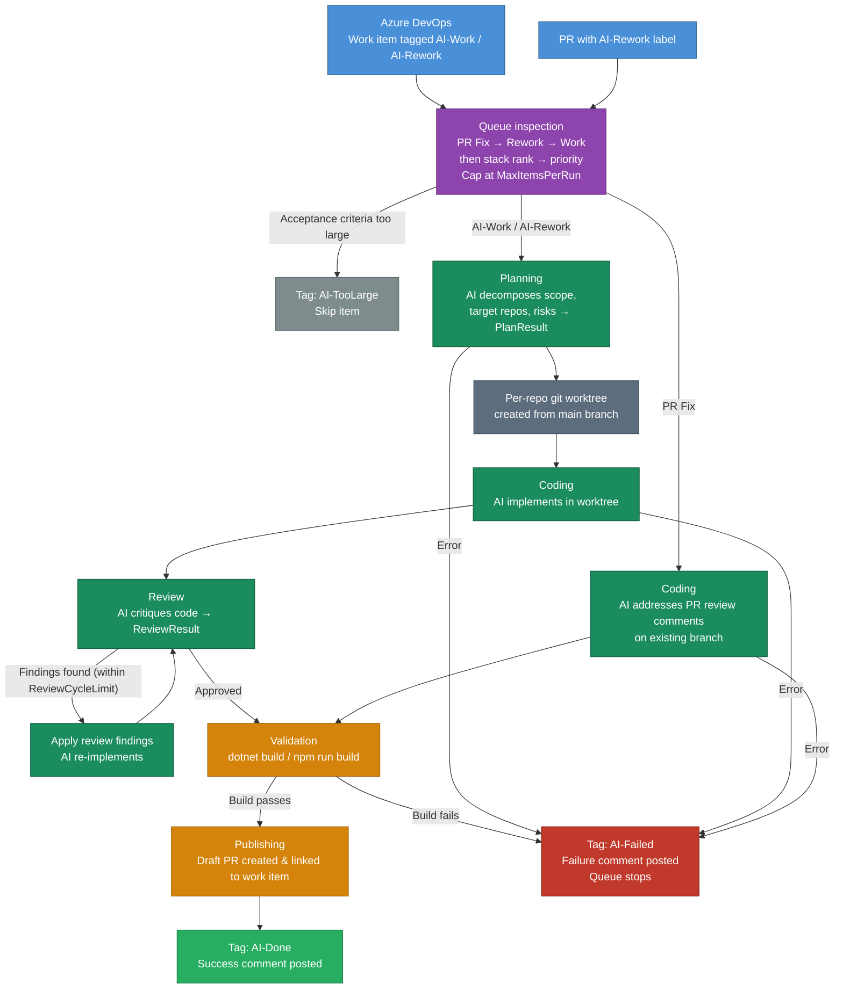
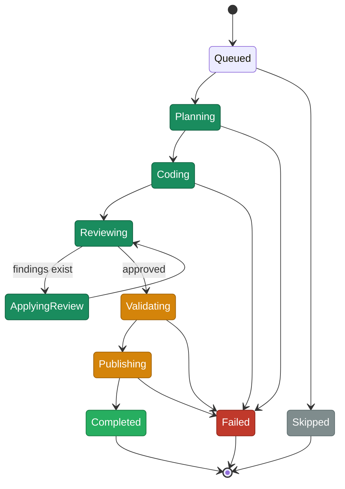

# Ado.AutonomousWorker

A `.NET 10` CLI tool that automates end-to-end AI-assisted development for Azure DevOps work items. It picks up backlog items tagged `AI-Work` or `AI-Rework`, runs them through a phase-based AI pipeline (Plan → Code → Review), and publishes draft PRs linked back to the work item. It also monitors existing AI-generated PRs for reviewer feedback (`AI-Rework` label) and automatically addresses review comments.

## How It Works

### Queue Kinds

| Kind          | Trigger                      | Phase flow                                                                          | On success                                      | On failure                                                                                        |
| ------------- | ---------------------------- | ----------------------------------------------------------------------------------- | ----------------------------------------------- | ------------------------------------------------------------------------------------------------- |
| **AI Work**   | Work item tagged `AI-Work`   | Queued → Planning → Coding → Reviewing → ApplyingReview → Validating → Publishing   | Tag `AI-Done`, post success comment             | Tag `AI-Failed`, post failure comment                                                             |
| **AI Rework** | Work item tagged `AI-Rework` | Same as AI Work                                                                     | Same as AI Work                                 | Same as AI Work                                                                                   |
| **PR Fix**    | PR has the `AI-Rework` label | Queued → Coding → Validating → Publishing                                           | Remove `AI-Rework` label from PR, tag `AI-Done` | Leave `AI-Rework` label intact (so developer knows it still needs attention), post failure comment |

PR Fix skips Planning and Reviewing — the existing PR branch defines the scope and the reviewer's comments are the quality signal.



### Task Phases



`task resume` is phase-aware: it reuses an existing plan instead of re-running planning, and preserves the worktree so you can fix issues manually and retry from any post-Coding phase.

### ADO Tag Lifecycle

| Tag           | Set when                               | Cleared when               |
| ------------- | -------------------------------------- | -------------------------- |
| `AI-Work`     | Manually by team                       | Run starts (tag removed)   |
| `AI-Rework`   | Manually after failed run              | Run starts (tag removed)   |
| `AI-Done`     | Run completes successfully             | —                          |
| `AI-Failed`   | Run hits a terminal error              | —                          |
| `AI-TooLarge` | Acceptance criteria exceeds size limit | —                          |

### PR Label Lifecycle

| Label          | Set when                                 | Cleared when                      |
| -------------- | ---------------------------------------- | --------------------------------- |
| `AI-Generated` | PR is created by the worker              | —                                 |
| `AI-Rework`    | Manually by reviewer to request AI fixes | PR Fix run completes successfully |

### Eligibility Rules

**AI-Work** items must:
- Have the `AI-Work` tag and **not** have `AI-Failed`
- Be in state `New`
- Be unassigned or assigned to `DefaultAssignee`

**AI-Rework** items must:
- Have the `AI-Rework` tag and **not** have `AI-Failed`
- Not be in state `Closed` or `Removed`
- Be assigned to `DefaultAssignee`

Items whose acceptance criteria exceed `MaxPromptComments` bullet points are tagged `AI-TooLarge` and skipped.

### Queue Ordering

The queue is processed in priority tiers: **PR Fix** items first, then **AI-Rework**, then **AI-Work**. Within each tier items are ordered by stack rank then priority. Duplicate work item IDs are deduplicated (first occurrence kept).

### Scope Classification

Each work item is classified as **Backend**, **Frontend**, or **Fullstack** to determine which repositories to target:

1. Explicit `Backend`/`Frontend` tags on the work item are checked first.
2. If no tags are present, keyword matching against the description and acceptance criteria is used (`api`, `database`, `service`, `migration`, `endpoint` → Backend; `ui`, `component`, `page`, `styling`, `screen` → Frontend).
3. If both or neither match, the scope defaults to **Fullstack**.

## Interactive Mode

Running `ado-worker` without arguments in an interactive terminal launches the REPL. You can also start it explicitly:

```powershell
ado-worker interactive
```

The session opens with the ASCII art splash banner and a prompt. Every command is available as a slash command:

```
❯ /run
❯ /task run --id 42
❯ /deploy --dry-run
```

### Completion

The popup opens as you type and narrows with each character. Completion is context-aware — it shows commands first, then subcommands, then flags:

| What you type | Popup shows |
| ------------- | ----------- |
| `/d` | `/deploy`, `/doctor` |
| `/deploy` → Tab | accepts, then shows `--dry-run`, `--tag`, `--backend`, `--frontend` |
| `/deploy --b` | `--backend` |
| `/task ` | `/task run`, `/task resume`, `/task set-phase` |
| `/task run ` | `--id`, `--pr`, `--iteration` |

Already-used flags are excluded from subsequent suggestions. Navigating history with `↑` and pressing `Tab` opens the popup for that command so you can add or change flags.

### Keyboard Shortcuts

| Key | Action |
| --- | ------ |
| `↑` / `↓` | Navigate completion list or command history |
| `Tab` | Accept highlighted suggestion and open next completion level |
| `Enter` | Accept highlighted suggestion and run the command immediately |
| `→` | Accept ghost text suggestion |
| `Esc` | Dismiss completions / clear input |
| `Ctrl+L` | Clear the screen |
| `Ctrl+U` | Clear the input line |
| `Ctrl+W` | Delete word backward |
| `Ctrl+C` | Exit interactive mode |

## Commands

```powershell
ado-worker                                                    # Launch interactive mode (no arguments in interactive terminal)
ado-worker interactive                                        # Launch interactive mode explicitly
ado-worker bootstrap                                          # Initialize storage and create user config
ado-worker doctor                                             # Verify configuration, repos, CLI tools, ADO access, pipelines
ado-worker queue                                              # List eligible AI-Work and AI-Rework items
ado-worker run                                                # Preview queue, then process all items (fail-fast)
ado-worker run --iteration "MyProject\Sprint 5"               # Override iteration path for the run
ado-worker deploy                                             # Trigger pipelines and promote work items
ado-worker deploy --dry-run                                   # Preview changes without triggering pipelines
ado-worker deploy --tag v1.2.3                                # Trigger from a git tag instead of branch
ado-worker deploy --backend                                   # Trigger only backend pipeline
ado-worker deploy --frontend                                  # Trigger only frontend pipeline
ado-worker executions                                         # List local task executions
ado-worker executions --active                                # Show only in-progress executions
ado-worker execution show --id <execution-id>                 # Show one execution with events and agent sessions
ado-worker execution show --last                              # Show the most recent execution
ado-worker version                                            # Show installed version and runtime info
ado-worker reset                                              # Delete the local worker database
ado-worker reset --force                                      # Delete without confirmation
ado-worker task run --id 12345                                # Run a single work item immediately
ado-worker task run --id 12345 --iteration "MyProject\Sprint 5"
ado-worker task run --pr 42                                   # Run a PR fix for a pull request
ado-worker task resume --execution-id <id>                    # Resume a prior execution
ado-worker task resume --last                                 # Resume the most recent execution
ado-worker task set-phase --last --phase Reviewing            # Rewind execution to an earlier phase
ado-worker task set-phase --execution-id <id> --phase Validating
ado-worker agent test                                         # Test connectivity to all configured agents
ado-worker agent test --role review                           # Test a single agent role
ado-worker ado comment-test --work-item 12345                 # Post a test markdown comment to a work item
ado-worker completion powershell                              # Print PowerShell tab-completion script
ado-worker ui splash                                          # Render the run splash banner
ado-worker ui splash --status "Queue run"
ado-worker ui run-preview                                     # Preview queue slice without running
```

### Command Details

| Command | Description |
| ------- | ----------- |
| `interactive` | Launches the REPL with slash commands, context-aware tab completion, ghost text, and command history. Started automatically when `ado-worker` is run with no arguments in an interactive terminal. |
| `bootstrap` | Creates the storage directory, SQLite database, and a starter `config.jsonc` with commented-out examples. Run this once after first install. |
| `doctor` | Runs diagnostics: checks storage, agent CLI availability, repository paths, remote branches, ADO connectivity, and pipeline IDs. Exit code 1 if any check fails. |
| `queue` | Queries Azure DevOps for eligible `AI-Work` and `AI-Rework` items and displays them in queue order. |
| `run` | Previews the queue slice (capped at `MaxItemsPerRun`), asks for confirmation, then processes each item. **Fail-fast:** stops immediately on the first failure. Pass `--iteration` to override the iteration path for all items in the run. |
| `deploy` | Triggers backend and/or frontend Azure Pipelines, polls until they succeed (or timeout), then promotes resolved sprint items to **Ready for test** and assigns them to the configured tester. User stories whose every child is now **Ready for test** or **Closed** are also promoted. |
| `task run` | Runs a single work item (`--id`) or PR fix (`--pr`) immediately. `--id` and `--pr` are mutually exclusive. Pass `--iteration` to override the iteration path. |
| `task resume` | Resumes a prior execution from its last phase. When a plan already exists it is reused. Existing worktrees are preserved so you can fix issues manually and retry. |
| `task set-phase` | Rewinds a completed or failed execution to `Reviewing`, `ApplyingReview`, `Validating`, or `Publishing`, then sets its status to `Failed` so `task resume` can continue from there. |
| `agent test` | Sends a minimal prompt to each configured agent (Plan, Code, Review, Pr) and reports whether each responded. Pass `--role` to test a single agent. |
| `ado comment-test` | Posts a sample markdown comment to a work item to verify rendering in Azure DevOps. Requires `--work-item <ID>`. |
| `reset` | Deletes the local SQLite database. Pass `--force` to skip confirmation. |

## Dashboard

The dashboard is a separate Blazor web application (`ado-worker-dashboard`) that provides a browser-based view of executions, events, agent output, plan and review results, and token usage. It reads the same SQLite database as the CLI.

### Install & Run

The install script packages both tools. To install only the dashboard:

```powershell
.\scripts\install-local-tool.ps1 -DashboardOnly
```

Run standalone during development:

```powershell
dotnet run --project src/Ado.AutonomousWorker.Dashboard
```

The default port is `5138` (configurable in `src/Ado.AutonomousWorker.Dashboard/appsettings.json`).

## Configuration

Configuration is loaded in this order (later sources override earlier ones):

1. `appsettings.json` (shipped with the tool)
2. `appsettings.{Environment}.json` (optional, environment-specific)
3. `appsettings.local.json` (git-ignored, for development overrides)
4. `%LocalAppData%\Ado.AutonomousWorker\config.jsonc` (user config, created by `bootstrap`)
5. Environment variables with prefix `AdoWorker_` (double underscore `__` for nesting)

For development, use `appsettings.local.json`. For a global install, use `config.jsonc` (created by `ado-worker bootstrap`).

### Worker

| Key                                    | Default | Description                                                                               |
| -------------------------------------- | ------- | ----------------------------------------------------------------------------------------- |
| `Worker:MaxItemsPerRun`                | `5`     | Maximum number of work items to process in a single `run`.                                |
| `Worker:ReviewCycleLimit`              | `1`     | Maximum number of code→review loops before accepting the code as-is.                      |
| `Worker:DryRun`                        | `false` | When true, simulates the run without making changes.                                      |
| `Worker:CleanupWorktreesAfterSuccess`  | `false` | Remove git worktrees after a successful run.                                              |
| `Worker:MaxPromptComments`             | `8`     | Maximum number of work item comments to include as prompt context.                        |
| `Worker:MaxPromptCommentCharacters`    | `4000`  | Maximum characters per comment included in prompt context.                                |
| `Worker:CurrentSprintFallback`         | `""`    | Fallback sprint path when the current sprint cannot be auto-detected.                     |

### Azure DevOps

| Key                                 | Default | Description                                                |
| ----------------------------------- | ------- | ---------------------------------------------------------- |
| `AzureDevOps:OrganizationUrl`       | —       | Azure DevOps organization URL (e.g. `https://dev.azure.com/myorg`). |
| `AzureDevOps:Project`               | —       | Azure DevOps project name.                                 |
| `AzureDevOps:Team`                  | —       | Team name for sprint detection.                            |
| `AzureDevOps:PersonalAccessToken`   | `""`    | PAT with work item and code scope. **Keep out of source control.** |
| `AzureDevOps:DefaultAssignee`       | `""`    | Email of the user considered the "bot" — items assigned to this user are eligible. |

### Agents

Each agent role is independently configured under `Agents:Plan`, `Agents:Code`, `Agents:Review`, and `Agents:Pr`:

| Key                  | Default  | Description                                                                   |
| -------------------- | -------- | ----------------------------------------------------------------------------- |
| `Provider`           | —        | `Claude` (invokes `claude` CLI) or `Codex` (invokes `codex` CLI).            |
| `Model`              | —        | Model name to pass to the provider (e.g. `sonnet`, `haiku`, `gpt-5.4`).      |
| `Effort`             | `"high"` | Effort level passed to the agent.                                             |
| `CommandPath`        | —        | Path to the CLI executable (defaults to `claude` or `codex` based on provider). |
| `TimeoutSeconds`     | `1800`   | Maximum time in seconds for a single agent invocation.                        |
| `ExtraArguments`     | `[]`     | Additional CLI arguments passed to the agent.                                 |
| `PromptTemplatePath` | `""`     | Optional path to a `.txt` prompt template file. Uses `{{Variable}}` substitution. |
| `ToolPolicy`         | `null`   | Optional tool policy to pass to the agent.                                    |

Default role assignments:
- **Plan**: Claude (sonnet) — decomposes the work item into scope, target repos, validation steps, and risks.
- **Code**: Claude (sonnet) — implements the feature in an isolated worktree.
- **Review**: Codex (gpt-5.4) — critiques the code, outputs structured findings.
- **Pr**: Claude (haiku) — generates PR title and description after the commit is made.

### Repositories

Each repository is configured under `Repositories:Backend` and `Repositories:Frontend`:

| Key                       | Default  | Description                                                      |
| ------------------------- | -------- | ---------------------------------------------------------------- |
| `Kind`                    | —        | `Backend` or `Frontend`.                                         |
| `Name`                    | —        | Display name.                                                    |
| `AzureDevOpsRepository`   | —        | Repository name in Azure DevOps.                                 |
| `BaseClonePath`           | —        | Local path to the main clone of the repository.                  |
| `RemoteUrl`               | `""`     | Git remote URL (used for worktree creation).                     |
| `MainBranch`              | `"main"` | Branch to create worktrees from.                                 |
| `WorktreeRoot`            | —        | Directory where worktrees are created.                           |
| `ValidationWorkingDirectory` | `""`  | Subdirectory to run validation commands in (relative to worktree). |
| `ValidationCommands`      | `[]`     | Shell commands to run during the Validating phase (e.g. `dotnet build`, `npm run build`). |

### Deploy

| Key                           | Default  | Description                                                                      |
| ----------------------------- | -------- | -------------------------------------------------------------------------------- |
| `Deploy:BackendPipelineId`    | `0`      | Azure DevOps pipeline definition ID for the backend pipeline.                    |
| `Deploy:FrontendPipelineId`   | `0`      | Azure DevOps pipeline definition ID for the frontend pipeline.                   |
| `Deploy:Branch`               | `"main"` | Branch to trigger both pipelines from.                                           |
| `Deploy:PollIntervalSeconds`  | `30`     | How often to poll pipeline run status.                                           |
| `Deploy:TimeoutMinutes`       | `60`     | Maximum total time to wait for both pipelines combined before aborting.          |
| `Deploy:ReadyForTestAssignee` | `""`     | Email of the user to assign when transitioning work items to **Ready for test**. |

Pipeline definition IDs can be found in Azure DevOps under **Pipelines** → select the pipeline → the ID is in the URL (`?definitionId=<id>`).

### Storage

| Key                    | Default                                          | Description                          |
| ---------------------- | ------------------------------------------------ | ------------------------------------ |
| `Storage:DataRoot`     | `%LocalAppData%\Ado.AutonomousWorker`            | Root directory for all worker data.  |
| `Storage:DatabasePath` | `{DataRoot}\worker.db`                           | SQLite database file path.           |
| `Storage:LogRoot`      | `{DataRoot}\logs`                                | Directory for runtime log files.     |
| `Storage:ArtifactRoot` | `{DataRoot}\artifacts`                           | Directory for execution artifacts.   |

In development mode (when `DOTNET_ENVIRONMENT=Development`), the storage root defaults to a `.data` directory in the repository root instead.

### Environment Variable Override

Any configuration key can be set via environment variables using the `AdoWorker_` prefix with double underscores for nesting:

```
AdoWorker_AzureDevOps__PersonalAccessToken=my-pat
AdoWorker_Worker__MaxItemsPerRun=10
AdoWorker_Deploy__BackendPipelineId=42
```

## Project Structure

| Project                               | Role                                                                                  |
| ------------------------------------- | ------------------------------------------------------------------------------------- |
| `Ado.AutonomousWorker.Cli`            | CLI entry point, commands, DI wiring, Spectre.Console UI                              |
| `Ado.AutonomousWorker.Core`           | Domain abstractions, models, enums, `RulesEngine`                                     |
| `Ado.AutonomousWorker.Dashboard`      | Blazor Server web dashboard (MudBlazor) for viewing executions, logs, and agent output |
| `Ado.AutonomousWorker.Infrastructure` | All real implementations (agents, state, ADO client, workspaces)                      |
| `Ado.AutonomousWorker.Tests`          | xUnit tests                                                                           |

## Development

### Build & Test

```powershell
# Build the CLI
dotnet build src/Ado.AutonomousWorker.Cli/Ado.AutonomousWorker.Cli.csproj

# Build the dashboard
dotnet build src/Ado.AutonomousWorker.Dashboard/Ado.AutonomousWorker.Dashboard.csproj

# Run all tests
dotnet run --project tests/Ado.AutonomousWorker.Tests/Ado.AutonomousWorker.Tests.csproj

# Run a single test class
dotnet run --project tests/Ado.AutonomousWorker.Tests/Ado.AutonomousWorker.Tests.csproj -- --filter "FullyQualifiedName~RulesEngineTests"

# Format all C# code
dotnet csharpier format .
```

Run `dotnet csharpier format .` after making code changes to keep formatting consistent.

### Install Modes

| Mode   | When to use                                      | Install command                                |
| ------ | ------------------------------------------------ | ---------------------------------------------- |
| Local  | You only need the command inside this repository | `.\scripts\install-local-tool.ps1`             |
| Global | You want `ado-worker` available from any folder  | `.\scripts\install-local-tool.ps1 -Scope Global` |

The install script also supports `-CliOnly` (skip dashboard) and `-DashboardOnly` (skip CLI).

### Local Tool

Install or refresh the repo-local .NET tool:

```powershell
.\scripts\install-local-tool.ps1
```

Run the local tool from the repository root:

```powershell
dotnet tool run ado-worker -- queue
```

For a shorter command name in the current PowerShell session:

```powershell
function ado-worker { dotnet tool run ado-worker -- @args }
```

### Global Tool

Install or refresh the global tool:

```powershell
.\scripts\install-local-tool.ps1 -Scope Global
```

Run from any folder:

```powershell
ado-worker queue
```

If `ado-worker` is not found after install, add `$HOME\.dotnet\tools` to your `PATH`.

### PowerShell Tab Completion

Load completion in the current shell:

```powershell
# Local tool
Invoke-Expression (((& { dotnet tool run ado-worker -- completion powershell }) -join "`n"))

# Global tool
Invoke-Expression (((& ado-worker completion powershell) -join "`n"))
```

Persist the alias and completion in your PowerShell profile:

```powershell
# Local tool
Add-Content -Path $PROFILE -Value "`nfunction ado-worker { dotnet tool run ado-worker -- @args }"
Add-Content -Path $PROFILE -Value "`nInvoke-Expression (((& { dotnet tool run ado-worker -- completion powershell }) -join \"`n\"))"

# Global tool
Add-Content -Path $PROFILE -Value "`nInvoke-Expression (((& ado-worker completion powershell) -join \"`n\"))"
```
