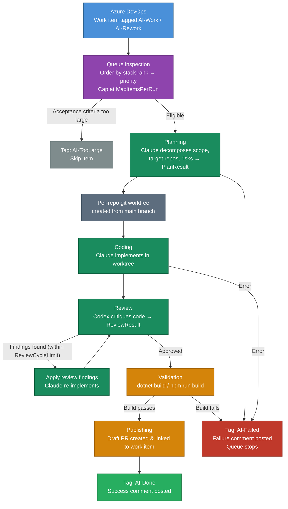
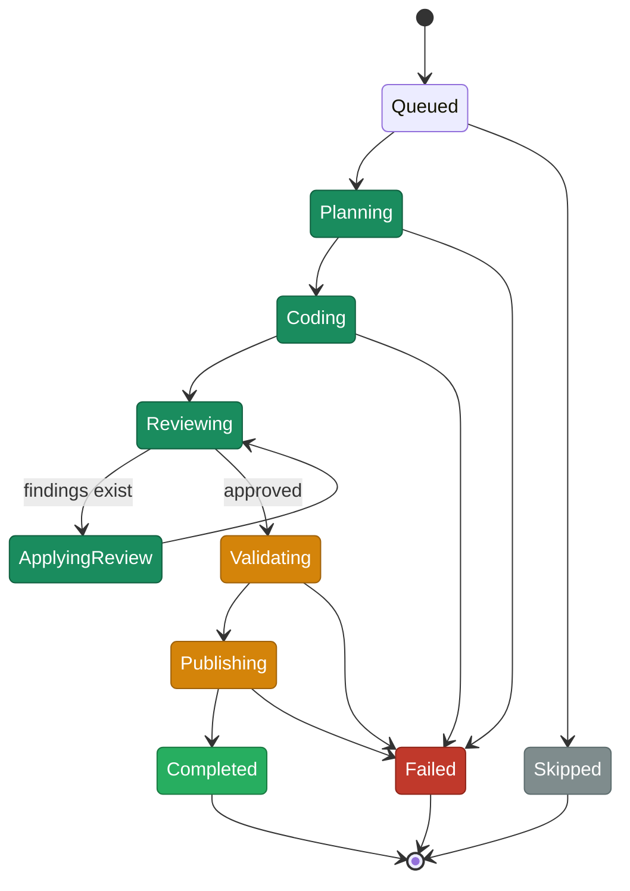

# Ado.AutonomousWorker

A `.NET 10` console application for automating repetitive Azure DevOps work around PRIIS backlog items.

## How It Works

The worker picks up work items tagged `AI-Work` (or `AI-Rework`) from the Azure DevOps backlog, runs them through a three-phase AI pipeline, and publishes a draft PR linked back to the work item.



### Task Phases



`task resume` is phase-aware: it reuses an existing plan instead of re-running planning, and resumes at the `Validating` checkpoint while preserving the worktree so you can fix issues manually and retry.

### ADO Tag Lifecycle

| Tag | Set when | Cleared when |
|---|---|---|
| `AI-Work` | Manually by team | Work starts |
| `AI-Rework` | Manually after failed run | Work starts |
| `AI-Done` | Run completes successfully | — |
| `AI-Failed` | Run hits a terminal error | — |
| `AI-TooLarge` | Acceptance criteria exceeds size limit | — |

## Features

- Query eligible `AI-Work` and `AI-Rework` user stories.
- Update work item state, tags, iteration path, comments, and child tasks.
- Orchestrate separate `Plan`, `Code`, and `Review` AI roles with configurable `Codex CLI` and `Claude Code CLI` providers.
- Create isolated git worktrees per repo task.
- Persist execution state in SQLite and keep append-only runtime logs/artifacts.
- Provide a terminal UI with commands for queue inspection, execution, resume, bootstrap, and health checks.

## Commands

```powershell
ado-worker bootstrap
ado-worker reset
ado-worker reset --force
ado-worker doctor
ado-worker queue
ado-worker executions
ado-worker executions --active
ado-worker version
ado-worker execution show --id <execution-id>
ado-worker execution show --last
ado-worker completion powershell
ado-worker run
ado-worker task run --id 12345
ado-worker task resume --execution-id <execution-id>
ado-worker agent test
ado-worker agent test --role review
ado-worker ui splash
ado-worker ui splash --status "Queue run"
ado-worker ui run-preview
```

The commands above assume `ado-worker` is available as a command name.
Use the local or global installation flow below depending on how you want to run it.

`ado-worker run` first previews the exact queue slice it will execute, including the current ordering and `MaxItemsPerRun` cap, and then starts immediately.

`ado-worker run` is intentionally fail-fast. If one queued work item fails, the command stops immediately so you can inspect and fix the issue before spending more agent tokens on the remaining backlog items.

Use `ado-worker agent test` to verify agent connectivity before running real tasks. It sends a minimal prompt to each configured agent (Plan, Code, Review) and reports whether each one responded successfully. Pass `--role plan|code|review` to test a single agent.

Use `ado-worker ui splash` to test the branded run banner without touching queue state, and `ado-worker ui run-preview` to render the exact queue slice that `ado-worker run` would process without starting any agent work.

`ado-worker task resume` is phase-aware. When a plan already exists it is reused instead of rerunning planning, and resumes after validation or publishing preserve the existing worktree so you can fix the issue manually and retry validation without resetting the branch.

## Configuration

Base configuration lives in:

- `src/Ado.AutonomousWorker.Cli/appsettings.json`

Local machine overrides should go in:

- `src/Ado.AutonomousWorker.Cli/appsettings.local.json`

Set Azure DevOps and provider credentials outside source control.

The worker also uses work item comments as prompt context for both `AI-Work` and `AI-Rework` items. Use `Worker:MaxPromptComments` and `Worker:MaxPromptCommentCharacters` to bound how much comment context is sent to the agents.

Execution state, logs, artifacts, and the local SQLite database are stored under:

- `%LocalAppData%\Ado.AutonomousWorker`

You can still override the storage paths in `appsettings.local.json` with absolute paths if needed.

## Development

```powershell
dotnet build src/Ado.AutonomousWorker.Cli/Ado.AutonomousWorker.Cli.csproj
dotnet test tests/Ado.AutonomousWorker.Tests/Ado.AutonomousWorker.Tests.csproj --no-build
```

## Which Install Mode

- Local tool: use this when you only need the command inside this repository.
- Global tool: use this when you want `ado-worker` to work from any folder on your machine.

## Local Tool

Use this when you want the tool to be available only inside this repository.

### Install

Install or refresh the repo-local .NET tool:

```powershell
.\scripts\install-local-tool.ps1
```

### Run

Run the local tool from the repository root:

```powershell
dotnet tool run ado-worker -- queue
```

If you want a shorter PowerShell command name for the current session:

```powershell
function ado-worker { dotnet tool run ado-worker -- @args }
```

Then you can run:

```powershell
ado-worker queue
```

### PowerShell Completion

Print the registration script:

```powershell
dotnet tool run ado-worker -- completion powershell
```

Load completion in the current shell:

```powershell
Invoke-Expression (((& { dotnet tool run ado-worker -- completion powershell }) -join "`n"))
```

Persist the alias and completion in your PowerShell profile:

```powershell
Add-Content -Path $PROFILE -Value "`nfunction ado-worker { dotnet tool run ado-worker -- @args }"
Add-Content -Path $PROFILE -Value "`nInvoke-Expression (((& { dotnet tool run ado-worker -- completion powershell }) -join \"`n\"))"
```

## Global Tool

Use this when you want `ado-worker` to work from any folder on your machine.

### Install

Install or refresh the global tool:

```powershell
.\scripts\install-local-tool.ps1 -Scope Global
```

### Run

Run the tool from any folder:

```powershell
ado-worker queue
```

If `ado-worker` is not found after install, add this path to `PATH`:

- `$HOME\.dotnet\tools`

### PowerShell Completion

Load completion in the current shell:

```powershell
Invoke-Expression (((& ado-worker completion powershell) -join "`n"))
```

Persist it in your PowerShell profile:

```powershell
Add-Content -Path $PROFILE -Value "`nInvoke-Expression (((& ado-worker completion powershell) -join \"`n\"))"
```
